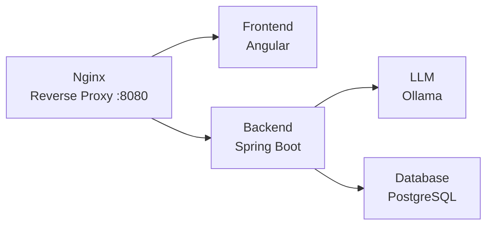

# Smart Pantry

A system for tracking food inventory via a traditional list interface or an AI chat assistant. Users can manage products and its quantites through a traditional list interface or natural language commands processed by an LLM.

## Features
- **Pantry Management** — full CRUD operations via a REST API and an interactive drawer-based table UI
- **AI Chat Assistant** — converse with an LLM to look up, add, update, or delete pantry products using natural language
- **Interactive UI Cards** — the assistant renders rich product cards (powered by [A2UI](https://a2ui.org/)) with live quantity display directly in the chat
- **Real-time Streaming** — LLM responses are streamed via Server-Sent Events (SSE) for instant feedback with a status indicator
- **Chat Memory** — chat history is persisted per session using JDBC-backed conversation memory, enabling multi-turn context-aware interactions
- **Tool Calling** — the assistant uses Spring AI tool annotations to automatically invoke pantry operations (add, update, delete, get, list) based on user intent
- **Fully Containerized** — one-command setup with Docker Compose (5 services)

## Tech Stack

| Layer    | Technology                         |
| -------- | ---------------------------------- |
| Frontend | Angular 21, PrimeNG, TypeScript    |
| Backend  | Spring Boot 3.5, Gradle            |
| Database | PostgreSQL 17                      |
| LLM      | Ollama with Qwen 2.5 3B, Spring AI |
| Proxy    | Nginx                              |

## Architecture



## Getting Started

### Prerequisites

- [Docker](https://docs.docker.com/get-docker/) & [Docker Compose](https://docs.docker.com/compose/install/)
- [Git](https://git-scm.com/install/)
- ~7 GB disk space for Docker images
- ~3 GB free RAM for all 5 running containers

### Setup

```bash
git clone git@github.com:ArtemDychenko/digital-smart-pantry.git
cd digital-smart-pantry
cp .env.example .env
```

Fill in the required environment variables in `.env`:

| Variable                | Description              |
| ----------------------- | ------------------------ |
| `POSTGRES_DB`           | PostgreSQL database name |
| `POSTGRES_USER`         | PostgreSQL username      |
| `POSTGRES_PASSWORD`     | PostgreSQL password      |

### Run

```bash
docker compose up -d --build
```

Once all services are healthy, open [http://localhost:8080](http://localhost:8080) in your browser.

> **Note:** The first startup may take a few minutes while the Ollama container downloads the Qwen 2.5 3B model.

## Usage

- **Right slide-out panel** — browse, add, edit, and delete products via the table interface
- **Home page** — type a message to the AI assistant (e.g. _"Add 12 Eggs to my pantry."_ or _"How many Apples do I have?"_) and interact with the returned products cards
